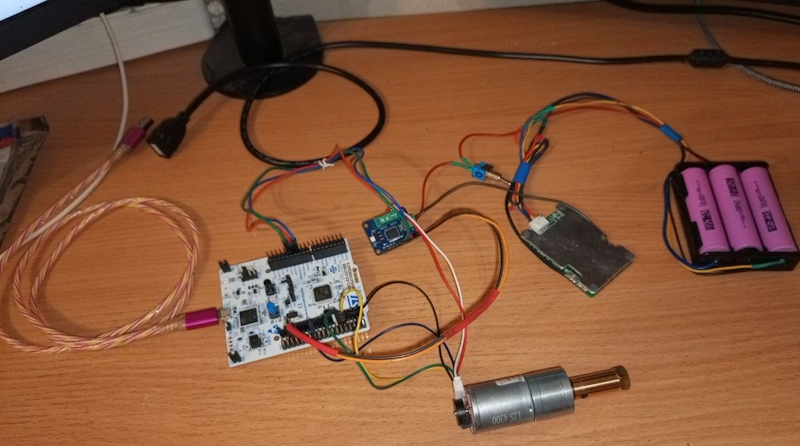

## 1. Overview

Control system for DC motor with encoder using T-method. Implemented at STM32 (look at Hardware part).
Porting of [motor-control-ff-pid](https://github.com/RaduKostashchuk/motor-control-ff-pid) from Arduino Uno.

Structure:
- Feed-forward + PID controller
- Battery voltage monitoring
- Telemetry over UART in CSV format
- Python-script for gathering and visualization

Stack:
- C
- STM32CubeIDE
- HAL

---

## 2. Architecture

**Layers:**

```
┌─────────────────────────────────────┐
│  Application                        │  ← orchestration
├─────────────────────────────────────┤
│  Serial Commands (Reader + Parser)  │  ← command from PC: MOTOR, STOP, MODE
├─────────────────────────────────────┤
│  Controller (FF + PID)              │  ← velocity control
├─────────────────────────────────────┤
│  Estimator (RPM from encoder)       │  ← velocity estimation
├─────────────────────────────────────┤
│  Hardware (Encoder, Motor, Driver)  │  ← physical layer
└─────────────────────────────────────┘
```

**Key points:**
- **TIM encoder mode** - 2х quadrature encoder mode
- **UART reader FSM** — Idle / Reading / Discarding - for supporting command batching and symbol by symbol command transmission
- **Hardware PID timer** — controller and estimator modules run at 100 Hz
- **UART DMA RX TX** - CPU offload

TIM2 (2x encoder) generates TRGO on each A-edge. TIM3 in slave reset mode resets on TRGO and captures the previous counter value in CCR1. 
The captured value is the time between consecutive encoder edges (1 µs resolution). Sliding average over 22 edges (one full quadrature cycle) cancels phase error and disc eccentricity harmonics, giving residual ±0.3% RPM. 
Controller runs at 100 Hz independent of estimator rate.

---

## 3. Hardware
| Unit | Model | Purpose |
|---|---|---|
| MCU | NUCLEO-G474RE | Control |
| Motor | JGA25-370B (12V, with gear (45:1, rpm range: 5 - 95) and encoder) | Drive |
| Driver | TB6612-V2 (dual H-bridge, 3.2A) | Motor control |
| Encoder | Embedded, 1980 ticks/rev | Motor feedback |
| Voltage divider | Custom | Voltage monitoring |

**Connection layout:**
- Encoder channel A - STM PA0
- Encoder channel B - STM PA1
- Driver PWM - STM PC0
- Driver direction 1 - STM PA5
- Driver direction 2 - STM PA7
- Voltage divider output - STM PC1
- Power supply for motor and MCU board (J5 at E5V) provided by 3S 18650 assembly via HXYP-TY-T20 BMS.
- Commands and telemetry exchange goes via CN1 micro Usb connector of MCU board.

**Timers**
- TIM1: CH1, PSC 32, ARR 255 - PWM for motor power (PWM frequency: 20 KHz; PWM range: 0 - 255).
- TIM2: CH1, CH2, 2x encoder mode - master timer for velocity estimation.
- TIM3: PSC 99, ARR 65535 - slave reset mode with input capture at ch1. Slave timer for t-method speed estimation.
- TIM6: PSC: 1699, ARR: 4999 - hardware timer for PID controller execution




---

## 4. Firmware

**Modules:**
- `main.c` - timers, callbacks, DMA and periodical execution configuration, application initialization.
- `Reader` — executes by DMA interrupt for rx buffer reading until end or end symbol.
- `Parser` — command parser into `Command` struct.
- `Encoder` — tick counter by reading hardware timer register.
- `Motor` — PWM and direction control.
- `Estimator` — velocity and position calculation.
- `Controller` — Feed forward + PI.
- `Application` — orchestration.

All modules are independent from hardware.

T-method covered by 10 regression tests: math, glitch rejection, sliding window edge, direction debounce, timeout reset.

---

## 5. Testing

Unit tests for host execution (Unity): **119**.

| Module | Tests | Coverage |
|---|---|---|
| format | 46 | INT32_MIN, float rounding, NULL guards, buffer overflow |
| parser | 31 | Valid/invalid commands, long tokens, edge whitespace |
| reader | 11 | FSM, ring buffer, multi-command, discard, CR/LF |
| estimator m-method + t-method | 20 | Bidirectional, glitch rejection, boundary, recovery |
| controller | 11 | P/I/D, anti-windup (both directions), deadband, saturation |

Run: `cd test && make test`

---

## 6. Control design

**Feed-forward:**
```
uff = 2.64 × targetRpm − 1
```
PID coefficients are selected experimentally: FF is adjusted to be slightly under-regulated (~1 RPM). This ensures that the 'I' always operates positive and does not drift.

**PID:**
- `kp = 0.25` — selected experimentally, by comparing overshoot, undershoot, and settle time at different values.
- `ki = 2.0` — selected experimentally, so as not to increase overshoot during step testing and not to drift at low settings.
- `kd = 0` — **disabled**.

**Anti-windup:** do not integrate if the output is in saturation and the error is in the same direction.

**Deadband:** `|error| < 0.3` → do not integrate in encoder error range.

**Discharge:** `2` → faster integral discharging when `|error| < 0` and `|error| > 0.3`.

---

## 7. Telemetry and analysis

**Firmware** sends CSV-strings:
```
T:<millis>,desired,current,error,p,i,d,uff,pwm,vbat
```

**Python-script** (`tools/telemetry_reader.py`):
- Opens Serial at 115200.
- Waits 2 seconds for stabilization.
- Sends `MODE AUTO`, `MOTOR 1 <rpm>`.
- Writes telemetry to CSV file.
- Sends — `STOP`.

**Graphs** (`tools/plot_telemetry.py`):
- Speed: desired / current.
- Metrics: p, i, d, uff, pwm.

---

## 8. Results

### Step response at 20, 50, 80 RPM

Deferred until PSU arrives.

---

## 9. Limitations

### Cogging and encoder harmonics

Two harmonics present in instantaneous RPM:
- **Period 2 edges** — A/B phase mismatch (duty ≠ 50/50).
- **Period 22 edges** — encoder disc eccentricity (confirmed by hand-rotation test).

Sliding average over 22 edges cancels both algebraically, residual ±0.3% RPM.

### D-term not viable on velocity control

Tested kd=0.3 with T-method avg-22. Residual RPM noise ±0.3 amplified by 1/Δt = 100× 
saturates D, causing ±13% oscillation under load. Heavier filtering (α=0.05, tau=200 ms) 
— too slow to damp 100 ms overshoot. D reserved for future position control, 
where position is not quantized by RPM resolution.

### Disturbance overshoot inherent to PI

27% overshoot on load release (both kp=0.25 and kp=0.5). I-term accumulates 46–64 
units to hold speed under load, then discharges over ~2s after release. Cannot be 
eliminated without D (not viable, see above) or feedforward of external load 
(not measurable). Acceptable for mobile robot with slowly varying loads.

### Voltage dependency

FF calibrated at 12.0V. At 11.9V battery — settle 5× slower (1300 ms vs 250 ms) 
because I-term compensates the voltage deficit. Voltage-compensated FF planned: 
`uff × (12.0 / V_measured)`. ADC voltage sensing already implemented (vbat in telemetry).

