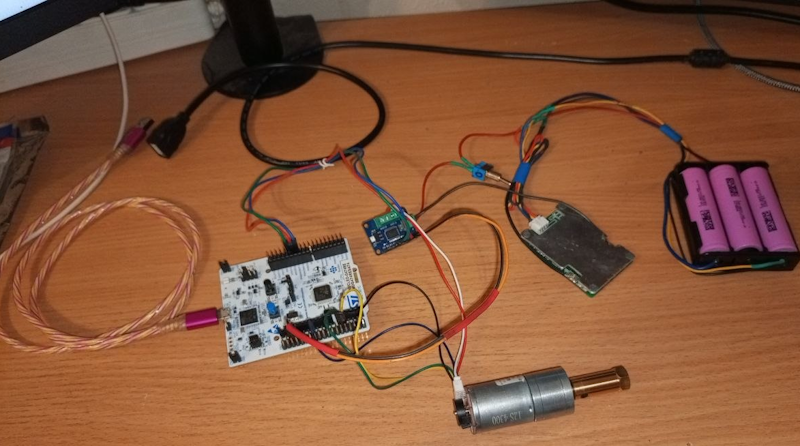
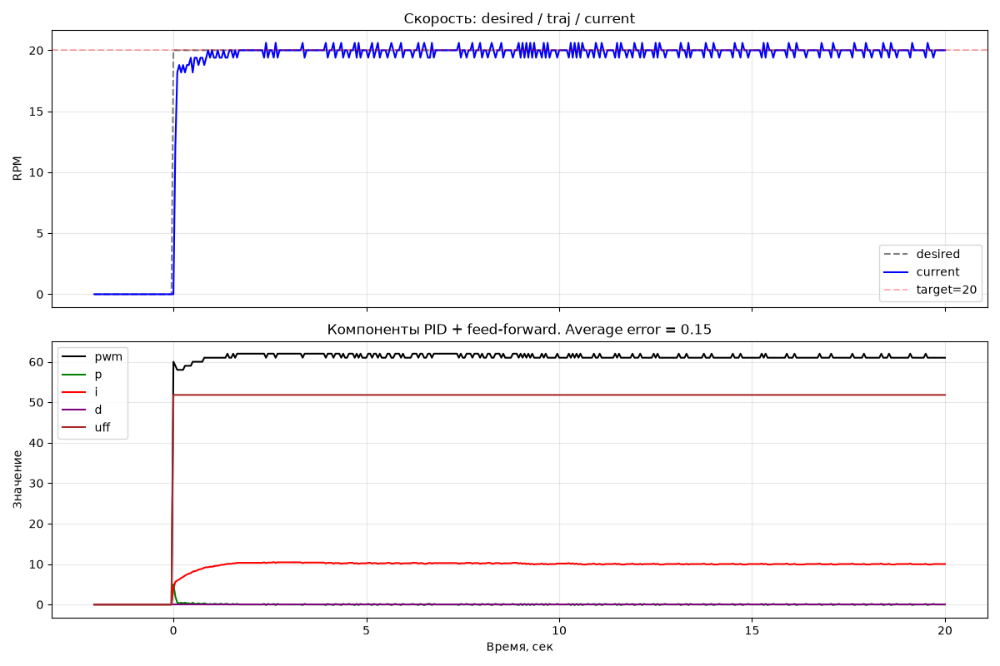
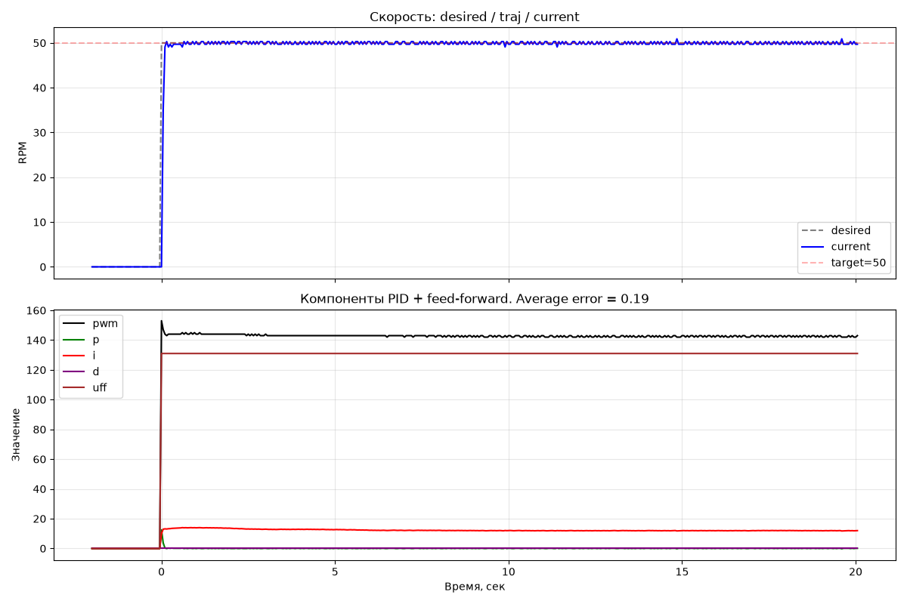
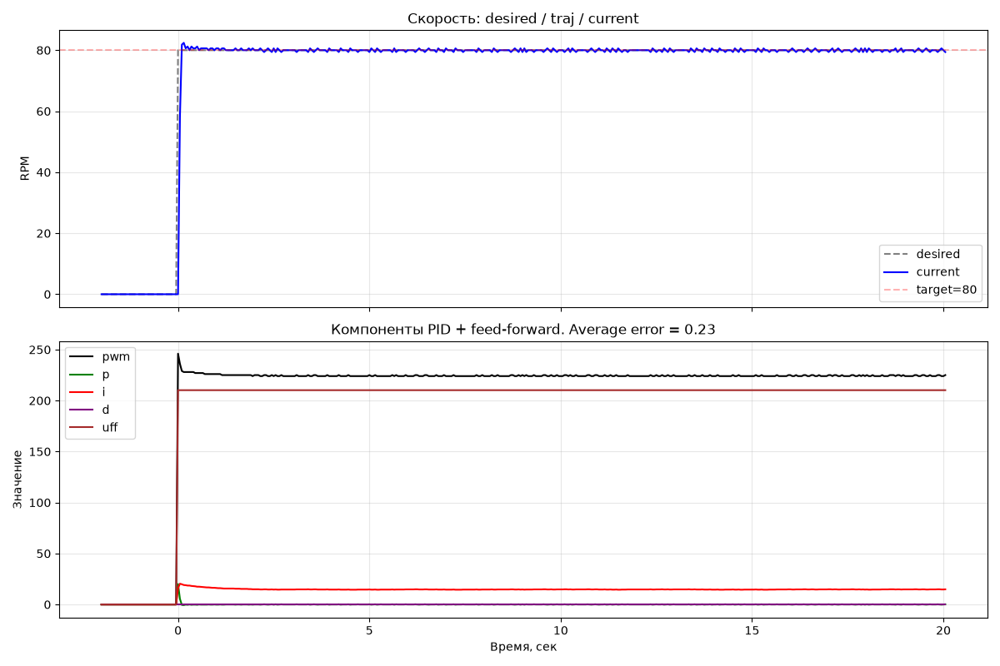
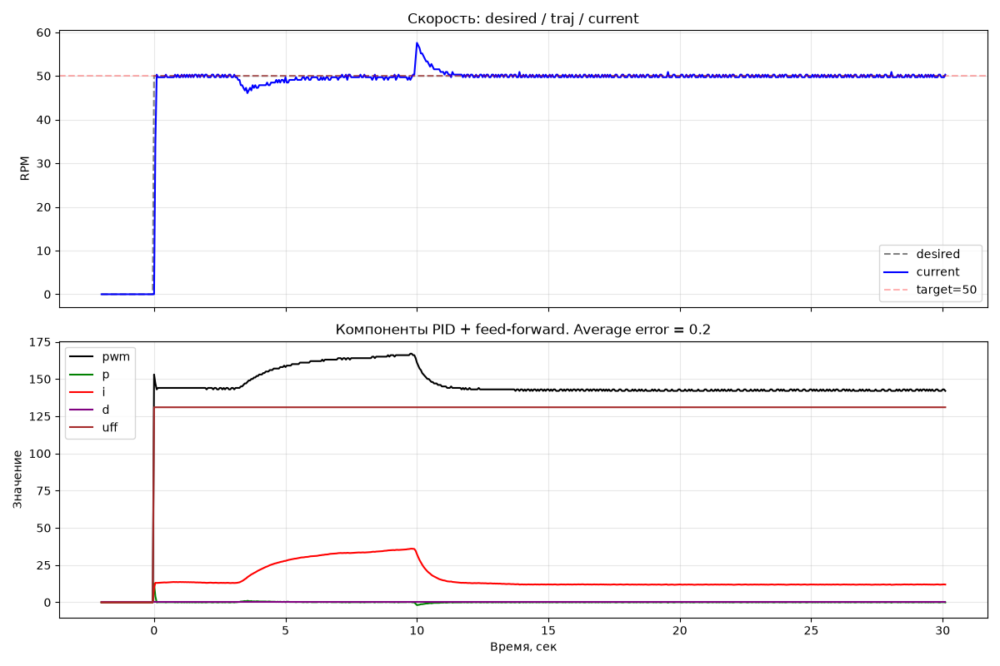

## 1. Обзор

Система управления скоростью двигателя постоянного тока с энкодером. Реализована на STM32 (см. ниже раздел Hardware).
Портирование [motor-control-ff-pid](https://github.com/RaduKostashchuk/motor-control-ff-pid) с Arduino Uno.

Состав:
- Feed-forward + PID регулятор
- Телеметрию через Serial в CSV
- Python-скрипт для сбора и визуализации

Стек:
- C
- STM32CubeIDE
- HAL

---

## 2. Архитектура

**Разделение на слои:**

```
┌─────────────────────────────────────┐
│  Application                        │  ← оркестратор остальных слоев
├─────────────────────────────────────┤
│  Serial Commands (Reader + Parser)  │  ← команды от PC: MOTOR, STOP, MODE
├─────────────────────────────────────┤
│  Controller (FF + PID)              │  ← управление скоростью
├─────────────────────────────────────┤
│  Estimator (RPM from encoder)       │  ← оценка скорости
├─────────────────────────────────────┤
│  Hardware (Encoder, Motor, Driver)  │  ← физический уровень
└─────────────────────────────────────┘
```

**Ключевые архитектурные решения:**
- **TIM encoder mode** - 4х квадратурный режим опроса энкодеров.
- **UART reader FSM** — Idle / Reading / Discarding - для поддержки посимвольной и батч отправки команд.
- **Аппаратный таймер для PID** — модули controller и estimator запускаются в ISR с частотой 20 Гц.
- **UART DMA RX TX** - разгрузка CPU.

Как и в исходном проекте Arduino используется М режим опроса энкодера, но частота опроса увеличена с 10 до 20 Гц.
Увеличение частоты опроса энкодера позволило уменьшить квантование измерения скорости в два раза, до 0.6 RPM.
Поскольку мотор низкооборотистый (10-95 RPM), дальнейшее увеличение частоты опроса энкодера нецелесообразно из-за того, 
что увеличится относительная погрешность измерения на малых оборотах.

---

## 3. Оборудование
| Компонент | Модель | Назначение |
|---|---|---|
| MCU | NUCLEO-G474RE | Управление |
| Motor | JGA25-370B (12V, с редуктором и энкодером) | Привод |
| Driver | TB6612-V2 (dual H-bridge, 3.2A) | Управление мотором |
| Encoder | Встроенный, 1980 ticks/rev | Обратная связь |

**Схема подключения:**
- Encoder channel A - STM PA0
- Encoder channel B - STM PA1
- Driver PWM - STM PC0
- Driver direction 1 - STM PA5
- Driver direction 2 - STM PA7
- Питание мотора и платы (J5 на E5V) обеспечивается сборкой из 3х аккумуляторов 18650 через драйвер. Сборка балансируется BMS HXYP-TY-T20.
- Телеметрия и команды передаются через micro usb CN1

**Таймеры**
- TIM1: CH1, PSC 32, ARR 255 - PWM сигнал для мотора (частота PWM 20КГц)
- TIM2: CH1, CH2, encoder mode - сигналы от энкодера
- TIM6: PSC 1699, ARR 4599 - задание частоты запуска PID регулятора (20Гц)




---

## 4. Firmware

**Модули:**
- `main.c` - конфигурация таймеров, DMA, ISR, колбэков, запуск модуля application в while(1).
- `Reader` — запускается по прерыванию DMA для чтения rx буфера до конца или символа конца сообщения.
- `Parser` — разбор команд в `Command` struct.
- `Encoder` — подсчёт тиков через чтение регистра аппаратного таймера.
- `Motor` — управление PWM и направлением.
- `Estimator` — расчёт RPM из дельты тиков.
- `Controller` — FF + PID.
- `Application` — оркестрация всех модулей.

Все модули, кроме оркестратора, независимы друг от друга и HAL.

---

## 5. Тестирование

Модульные тесты для запуска на хосте (Unity): **~109**.

| Module | Tests | Coverage |
|---|---|---|
| format | 44 | INT32_MIN, float rounding, NULL guards, buffer overflow |
| parser | 29 | Valid/invalid commands, long tokens, edge whitespace |
| reader | 15 | FSM, ring buffer, multi-command, discard, CR/LF |
| estimator | 13 | Bidirectional, glitch rejection, boundary, recovery |
| controller | 13 | P/I/D, anti-windup (both directions), deadband, saturation |

Запуск: `cd test && make test`

---

## 6. Дизайн управления

**Feed-forward:**
```
uff = 2.64 × targetRpm − 1
```
Коэффициенты сняты **экспериментально**: FF подобран так, чтобы **слегка недорегулировать** (~1 RPM). Тогда `I` всегда работает «в плюс» и **не дрейфует**.

**PID:**
- `kp = 0.25` — подобран экспериментально, сравнением overshoot, undershoot, settle time на разных значениях.
- `ki = 2.0` — подобран экспериментально, так чтобы не усиливать overshoot при step test и не дрейфовать на малых уставках.
- `kd = 0` — **обоснованно отключён** (см. Ограничения).

**Anti-windup:** не интегрировать, если выход в saturation и ошибка в ту же сторону.

**Deadband:** `|error| < 0.3` → не интегрировать (шум энкодера не накапливается).

**Discharge:** `2` → быстрее разряжать интеграл при `|error| < 0` и `|error| > 0.3`.

---

## 7. Телеметрия и анализ

**Прошивка** шлёт CSV-строки:
```
T:<millis>,desired,current,error,p,i,d,uff,pwm
```

**Python-скрипт** (`tools/telemetry_reader.py`):
- Открывает Serial на 115200.
- Ждёт 2 сек стабилизации.
- Отправляет `MODE AUTO`, `MOTOR 1 <rpm>`.
- Пишет телеметрию в CSV.
- В конце — `STOP`.

**Графики** (`tools/plot_telemetry.py`):
- Скорость: desired / current.
- Компоненты: p, i, d, uff, pwm.

---

## 8. Результаты

### Step response на 20, 50, 80 RPM

| Уставка | Overshoot | Undershoot | Settle time |
|---|---|---|---|
| **20** | 0% | 0% | ~900 мс |
| **50** | 0% | 0% | ~650 мс |
| **80** | +2% | 0% | ~550 мс |





### Сравнение с Arduino

| Метрика | Arduino | STM32 | Улучшение |
|---|---|---|---|
| Encoder resolution | 495 ticks/rev, 1× | 1980 ticks/rev, 4× | 4× |
| Sample rate | 10 Hz | 20 Hz | 2× |
| Overshoot @ 50 RPM | ~24% | 0% | ✨ |
| Settle time @ 50 RPM | ~700 мс | ~650 мс | ≈ |
| Steady-state noise | ±0.9 RPM | ±0.3 RPM | 3× |


### Disturbance rejection

Мотор нагружался рукой на 3–5 секунде. Скорость падала до 45 RPM, `i` рос до 50, после снятия нагрузки — **восстановление за ~1,5 сек**.



**Наблюдение:** увеличение разрешения энкодера в 4 раза по сравнению с Arduino проектом позволило увеличить частоту опроса энкодера в два раза
при сохранении приемлемой погрешности измерения на малых оборотах двигателя.
Из графиков видно что уменьшился overshoot и величина колебаний вблизи целевого значения скорости.

---

## 9. Ограничения

Поскольку частота опроса энкодера увеличена всего в два раза, внедрение D-составляющей регулятора отложено на следующий этап — когда будет использован T-метод опроса энкодера.

